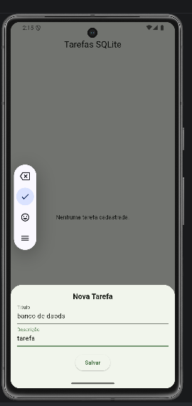
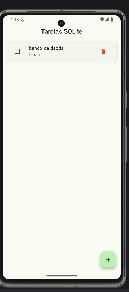
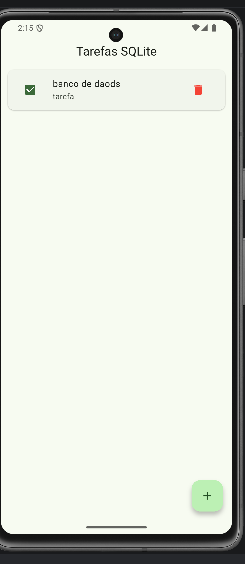
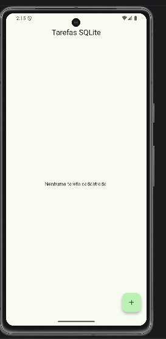
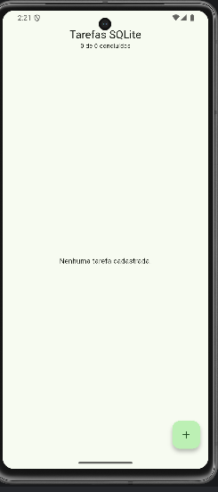
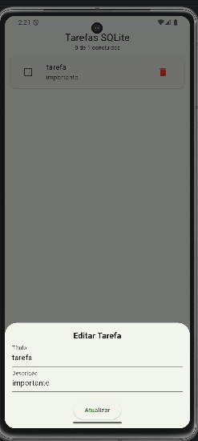
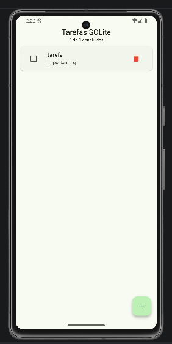
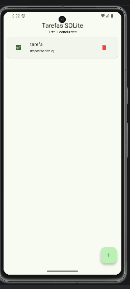
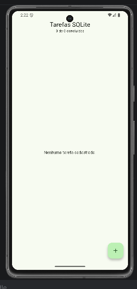

# Aula 13 — Gerenciador de Tarefas com SQLite (sqflite)

Aplicativo Flutter de gerenciamento de tarefas com persistência de dados local em banco relacional SQLite, desenvolvido no roteiro prático da Aula 13.

| | |
|---|---|
| **Aluno** | Henrique Tavares Andrade |
| **Disciplina** | Programação para Dispositivos Móveis I |
| **Professor** | Diego Menegassi |
| **Semestre** | 2026/2 |

## Funcionalidades

O app implementa o CRUD completo sobre a tabela `tarefas`:

| Operação | Método sqflite | Ação no app |
|---|---|---|
| **Create** | `db.insert()` | Cadastra uma nova tarefa pelo formulário (BottomSheet) |
| **Read** | `db.query()` | Lista as tarefas, das mais recentes para as mais antigas |
| **Update** | `db.update()` | Edita título/descrição ao tocar na tarefa e marca como concluída pelo Checkbox |
| **Delete** | `db.delete()` | Remove a tarefa pelo botão de lixeira |

As tarefas continuam salvas mesmo depois de fechar e reabrir o aplicativo.

### Desafio implementado — Nível Básico: Contador de Concluídas

O AppBar exibe um contador com o total de tarefas e quantas estão concluídas (ex.: *1 de 1 concluídas*). O valor é recalculado automaticamente sempre que a lista é recarregada do banco.

## Tecnologias

- [Flutter](https://flutter.dev) / Dart
- [sqflite](https://pub.dev/packages/sqflite) — acesso ao SQLite
- [path](https://pub.dev/packages/path) — montagem do caminho do arquivo do banco
- Material 3

## Arquitetura

```
lib/
├── database/
│   └── database_helper.dart   # Conexão Singleton + operações CRUD
├── models/
│   └── tarefa_model.dart      # Modelo com toMap() e fromMap()
├── screens/
│   └── tarefas_screen.dart    # Tela com ListView.builder, Checkbox e BottomSheet
└── main.dart                  # Ponto de entrada do app
```

- **TarefaModel**: converte objetos Dart em `Map` para gravar no banco (`toMap`) e linhas do banco em objetos (`fromMap`). Como o SQLite não tem tipo booleano, o campo `concluida` é armazenado como `1`/`0`.
- **DatabaseHelper**: padrão Singleton, que garante uma única conexão com o arquivo `tarefas_app.db`. A tabela é criada no `onCreate` na primeira execução.
- **TarefasScreen**: após cada operação no banco, a lista é recarregada e a interface atualizada com `setState`.

## Como executar

```bash
git clone URL_DO_REPOSITORIO
cd aula13_sqlite
flutter pub get
flutter run
```

> O `sqflite` funciona em Android e iOS. Execute em um celular ou emulador, não no navegador ou no Windows.

## Screenshots

### CRUD básico

<table>
  <tr>
    <td align="center"><br><sub>Cadastro de nova tarefa</sub></td>
    <td align="center"><br><sub>Tarefa salva na lista</sub></td>
    <td align="center"><br><sub>Tarefa marcada como concluída</sub></td>
    <td align="center"><br><sub>Lista vazia após exclusão</sub></td>
  </tr>
</table>

### Desafio — Contador de concluídas

<table>
  <tr>
    <td align="center"><br><sub>Contador: 0 de 0</sub></td>
    <td align="center"><br><sub>Edição de tarefa</sub></td>
    <td align="center"><br><sub>Tarefa editada: 0 de 1</sub></td>
  </tr>
  <tr>
    <td align="center"><br><sub>Tarefa concluída: 1 de 1</sub></td>
    <td align="center"><br><sub>Após exclusão: 0 de 0</sub></td>
    <td></td>
  </tr>
</table>